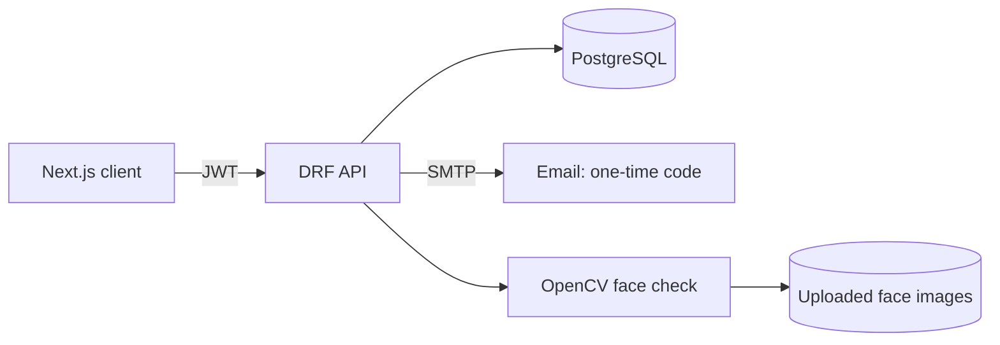

# Secure Password Manager — API

Django REST Framework backend for a password manager with JWT authentication, emailed one-time codes, and face verification.

**Frontend:** [secure-password-manager-web](https://github.com/bbramadhikari/secure-password-manager-web)

## Overview

This service handles accounts, authentication and the password vault for the Secure Password Manager. A user signs up, logs in with JWT, stores credentials for websites, and must pass a second check — a one-time code sent by email, or a face match against an image they registered — before the web client reveals saved passwords.

## Problem

People reuse weak passwords because remembering many strong ones is hard. A password manager solves that only if the vault is protected by more than a single password. This project explores layered access: a session login, then step-up verification (OTP or face) before sensitive data is shown.

## Features

- Sign-up and login with JWT access and refresh tokens (`djangorestframework-simplejwt`)
- Custom user model extending Django's `AbstractUser`
- Vault entries per user: site name, URL and password
- One-time codes generated with `pyotp` and delivered by email over SMTP
- Face image upload and face verification with OpenCV
- All vault, OTP and face endpoints require an authenticated user (`IsAuthenticated`)
- Configuration (secret key, database, email, debug mode) read from environment variables

## Tech stack

| Layer | Choice | Why |
|---|---|---|
| Framework | Django + Django REST Framework | Mature auth, ORM and migrations; DRF gives serializers and permission classes out of the box |
| Auth | Simple JWT | Stateless tokens suit a separate Next.js client |
| Database | PostgreSQL | Relational data (users → vault entries → images) with strong integrity guarantees |
| OTP | pyotp | Standard, well-tested one-time-code generation |
| Face processing | OpenCV (Haar cascade) | Lightweight face detection without a GPU |
| Config | python-dotenv | Keeps secrets out of source control |

## Architecture



Request flow for revealing a saved password:

1. The client logs in and receives an access/refresh token pair.
2. The user asks to view passwords; the client calls `send-otp-email/`, or captures a face image.
3. The API verifies the code (`verify-otp/`) or the face (`verify-face-id/`).
4. On success the client shows the vault.

## Data model

| Model | Key fields |
|---|---|
| `CustomUser` | Django user fields, OTP secret, registered face image |
| `Password` | `user` (FK), `domain_name`, `link`, `password`, `created_at`, `updated_at` |
| `Image` | `user` (FK), uploaded image, image URL |

## API

All routes are under `/api/users/` unless noted. Routes marked 🔒 require `Authorization: Bearer <access token>`.

| Method | Path | Description |
|---|---|---|
| POST | `signup/` | Create an account, returns tokens |
| POST | `login/` | Log in, returns tokens |
| POST | `/api/token/refresh/` | Exchange a refresh token for a new access token |
| GET 🔒 | `me/` | Current user's profile |
| POST 🔒 | `add_password/` | Save a vault entry |
| GET 🔒 | `send-otp-email/` | Email a one-time code to the user |
| GET 🔒 | `verify-otp/?otp=<code>` | Verify the one-time code |
| POST 🔒 | `image-upload/` | Register a face image |
| GET 🔒 | `image/` | List the user's registered images |
| POST 🔒 | `verify-face-id/` | Verify a captured face against the registered image |

## Getting started

**Prerequisites:** Python 3.10+, PostgreSQL

```bash
git clone https://github.com/bbramadhikari/secure-password-manager-api.git
cd secure-password-manager-api

python -m venv venv
source venv/bin/activate        # Windows: venv\Scripts\activate
pip install -r requirements.txt

cd password_manager
cp .env.example .env            # then fill in your values
python manage.py migrate
python manage.py runserver      # http://127.0.0.1:8000
```

## Environment variables

See [`password_manager/.env.example`](password_manager/.env.example).

| Variable | Purpose |
|---|---|
| `DJANGO_SECRET_KEY` | Django secret key |
| `DEBUG` | `True` for local development; defaults to `False` |
| `NAME`, `USER`, `PASSWORD`, `HOST`, `PORT` | PostgreSQL connection |
| `EMAIL_HOST`, `EMAIL_PORT`, `EMAIL_USE_TLS` | SMTP server for one-time codes |
| `EMAIL_HOST_USER`, `EMAIL_HOST_PASSWORD`, `DEFAULT_FROM_EMAIL` | SMTP credentials and sender |

## Testing

```bash
python manage.py test
```

Automated API tests are not written yet; they are the next item on the roadmap below.

## Roadmap

- Encrypt vault passwords at rest (AES-256-GCM, key from environment)
- Audit log of every vault read and change
- API tests for auth, OTP, vault access and cross-user permission checks
- Update and delete endpoints for vault entries
- Docker Compose setup (Django + PostgreSQL)
- Configurable CORS and allowed hosts for deployment
